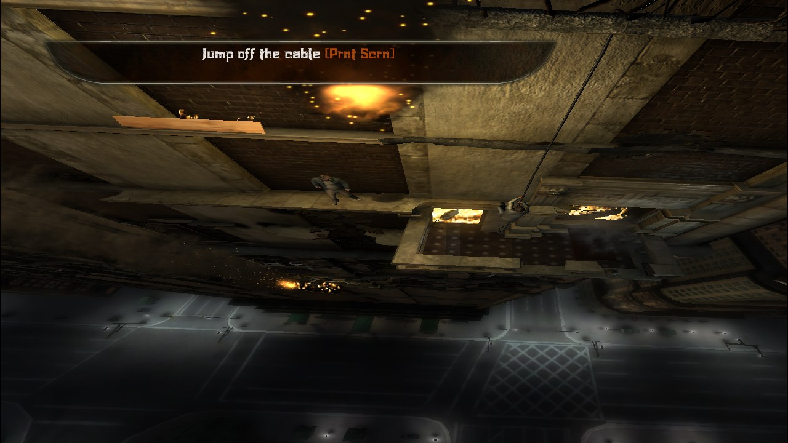

> [!IMPORTANT]
> **💬 DOWNLOAD & DISCUSSION**
>
> **[Join the Flat2VR Discord](https://discord.gg/P4q9zt7ek)** · **[Open the Alone in the Dark (2008) thread](https://discord.com/channels/747967102895390741/1566374215102496918)**
>
> Get the mod and share feedback in the game’s Flat2VR thread.

  

## 📦 INSTALLATION

1. Install **Alone in the Dark (2008)** on PC.
2. Extract the complete mod folder and connect your Quest via Link or Air Link.
3. Run **`RUN.bat`** inside the mod folder. A preview session lasts up to five minutes.

## ⚡ FEATURES

### HOLD THE TOOLS YOU FIND

Point a flashlight, hold a lighter or spray can, or aim your pistol with your tracked hand.

### HANDS AND OBJECTS STOP AT WALLS

Reach up to a wall with your hand or a held bottle. It stops at the surface and comes free when you pull back.

## 📸 In-game screenshots

  
  

[Tester credits](TESTERS.md)

## 🎮 Other VR mods

| VR mod | Highlights |
| --- | --- |
| [Battlefield 3: VRevamp](https://github.com/Monsterdeadwood/Battlefield-3-VRevamp) | Body holsters, two-handed aiming, and changing campaign skies |
| [Burnout Paradise Remastered VR](https://github.com/Monsterdeadwood/BUrnOutPvr) | Head-tracked driving with stereo boost and exhaust effects |
| [Crysis 2: VRevamp](https://github.com/Monsterdeadwood/C2VR) | Telekinesis, switchable weapon hands, and randomized weather and time of day |
| [NOVA · CS:GO Legacy VR](https://github.com/Monsterdeadwood/CSGOVR) | Controller aiming and working optics in local bot matches |
| [Metro 2033 VR](https://github.com/Monsterdeadwood/Metro2033VR) | Telekinesis, hand lightning, and object physics |
| [Rainbow Six Siege VR](https://github.com/Monsterdeadwood/SiegeVR) | Tracked weapons and two-handed foregrip handling |
| [Star Wars: The Force Unleashed II VR](https://github.com/Monsterdeadwood/TFU2VR) | Independent sabers, limb cuts, Force powers, and crate flight |
| [TimeShift VR](https://github.com/Monsterdeadwood/TimeShiftVR) | Randomized weather, day and night, and roomscale crouching |
| [Titanfall 1 VR](https://github.com/Monsterdeadwood/Titanfall1VR) | Aim with the controller and look around a Titan cockpit |
| [You Are Empty: Absolute Edition VR](https://github.com/Monsterdeadwood/YouAreEmptyAEVR) | Tracked weapons and melee with either hand |
