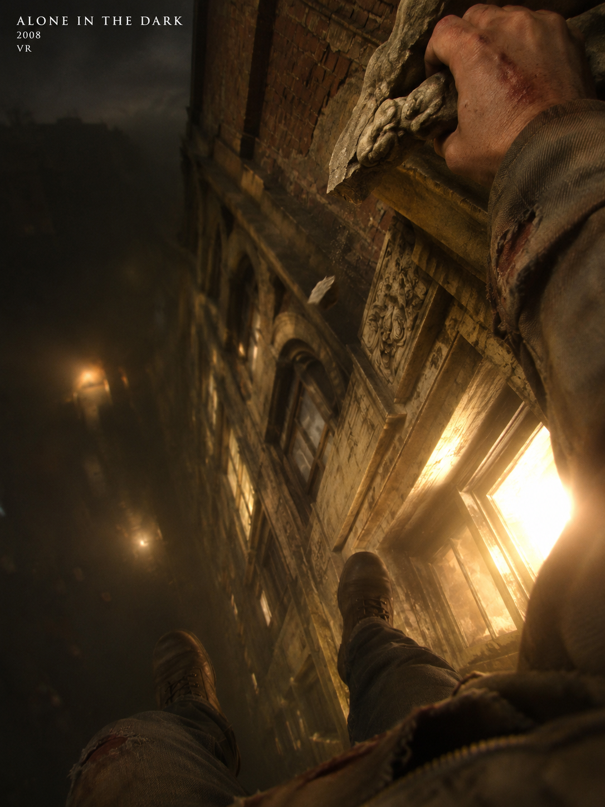

> [!IMPORTANT]
> **TEST BUILDS & DISCUSSION**
>
> **[Join the Flat2VR Discord](https://discord.gg/P4q9zt7ek)** · **[Open the Alone in the Dark (2008) thread](https://discord.com/channels/747967102895390741/1566374215102496918)**
>
> Download the latest test build from the thread and share your results there.

  

## INSTALLATION

1. Install the supported **Alone in the Dark (2008)** PC build and get the **C280 OpenXR** test package.
2. Extract the full mod folder and connect your Quest via Link or Air Link.
3. Run **`RUN.bat`** inside the mod folder. The C280 preview runs for up to five minutes per session.

## FEATURES

### HOLD THE GAME’S ORIGINAL TOOLS

C280 tracks your pistol hand and fires from the muzzle. Other interaction tests used the same tracked grip for a flashlight, lighter, spray can and bottle.

### THE WALL STOPS WHAT YOU HOLD

A held bottle blocks against a tested wall and moves again when you pull it away. R24 tested wall contact for empty hands too.

### PICK UP A CHAIR

An R24 prototype let you carry a stock chair and release it back into the game’s physics.

Object interactions were tested with XR Sim and XR Tape. The chair and empty-hand wall checks are separate R24 prototypes.

[Other VR mods](PORTFOLIO.md) · [Tester credits](TESTERS.md) · [Build details](docs/PROJECT_STATUS.md)
