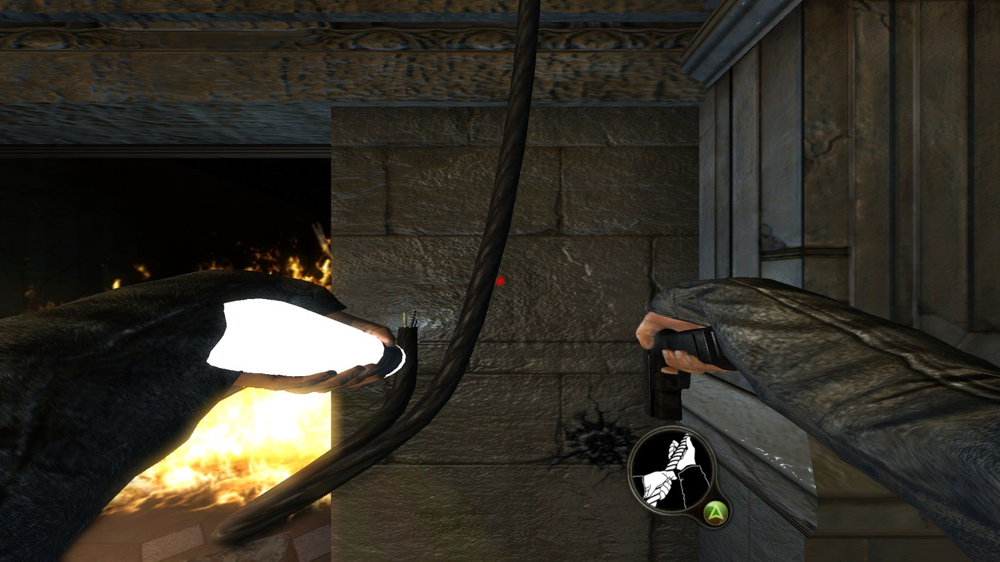

> [!IMPORTANT]
> **💬 DOWNLOAD & DISCUSSION**
>
> **[Join the Flat2VR Discord](https://discord.gg/P4q9zt7ek)** · **[Open the Alone in the Dark (2008) thread](https://discord.com/channels/747967102895390741/1566374215102496918)**
>
> Get the mod and share feedback in the game’s Flat2VR thread.

  

## 📦 INSTALLATION

1. Install **Alone in the Dark (2008)** on PC.
2. **Put the mod archive next to the game’s `.exe`.** Extract the complete archive there and keep the mod folder intact.
3. Connect your Quest via Link or Air Link and run **`RUN.bat`** from the extracted mod folder. A preview session lasts up to five minutes.

## ⚡ FEATURES

### 🔦 Point a flashlight, hold a lighter or raise your pistol

Move your hand to aim your light or point the pistol. You can also pick up items like bottles and spray cans.

### 🪑 Carry a chair or throw a bottle

Grab a chair, walk with it and drop it back into the room. A bottle can be picked up and thrown.

### ✋ Put your hands or a held object against a wall

Reach to the wall with your free hand or bring a bottle up against it. They stop at the surface and come free when you pull away.

## 📸 In-game screenshots

  
  

[Tester credits](TESTERS.md)

## 🎮 Other VR mods

| VR mod | Highlights |
| --- | --- |
| [Battlefield 3: VRevamp](https://github.com/Monsterdeadwood/Battlefield-3-VRevamp) | Pull dropped guns toward you, draw from body slots, and fight through changing weather |
| [Burnout Paradise Remastered VR](https://github.com/Monsterdeadwood/BUrnOutPvr) | Pull the handbrake, hit boost, and look around while racing |
| [Crysis 2: VRevamp](https://github.com/Monsterdeadwood/C2VR) | Hit enemies with your fists or weapon, throw them with telekinesis, and swap weapon hands |
| [NOVA · CS:GO Legacy VR](https://github.com/Monsterdeadwood/CSGOVR) | Aim and feel recoil, take scoped shots, and buy gear from the controllers |
| [Metro 2033 VR](https://github.com/Monsterdeadwood/Metro2033VR) | Lift an enemy, shock them with your hand, or bounce a glowing core down a tunnel |
| [Rainbow Six Siege VR](https://github.com/Monsterdeadwood/SiegeVR) | Brace a rifle by its foregrip, drop prone and use gadgets |
| [Star Wars: The Force Unleashed II VR](https://github.com/Monsterdeadwood/TFU2VR) | Ignite two sabers independently, cut limbs, and ride a crate with the Force |
| [TimeShift VR](https://github.com/Monsterdeadwood/TimeShiftVR) | Punch or hit with your weapon, control time, and fight through changing weather |
| [Titanfall 1 VR](https://github.com/Monsterdeadwood/Titanfall1VR) | Call and board a Titan, catch shots with Vortex, and eject |
| [You Are Empty: Absolute Edition VR](https://github.com/Monsterdeadwood/YouAreEmptyAEVR) | Shoot with one hand, hit with either, and reach out against walls |
