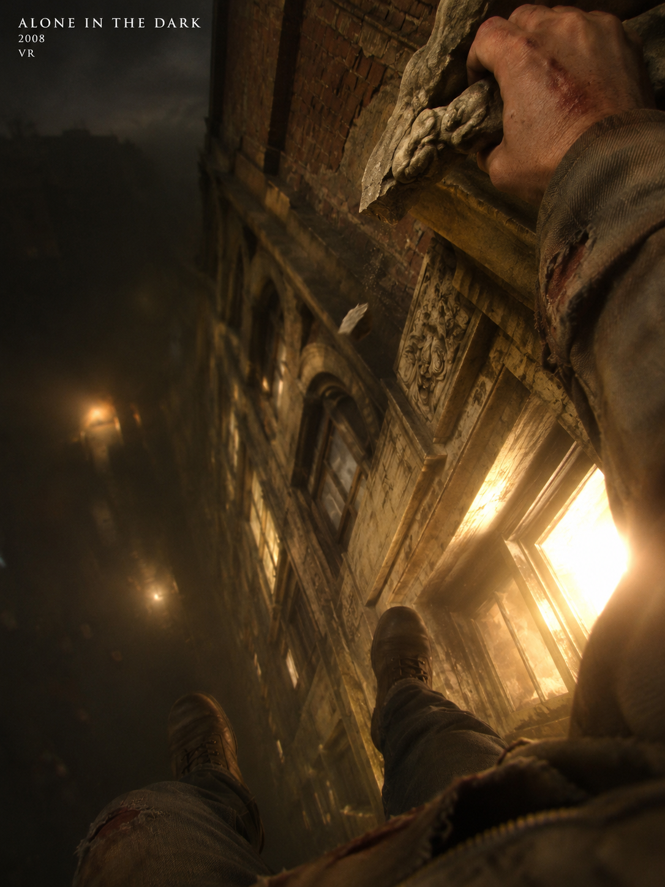

> [!IMPORTANT]
> **[ТЕСТИРОВАНИЕ И ОБСУЖДЕНИЕ · FLAT2VR DISCORD](https://discord.gg/P4q9zt7ek)**
> Тестирование, запрос сборок, отзывы и обсуждение проходят в **Flat2VR Modding Discord**. Перейди на сервер и найди тему **Alone in the Dark 2008 VR**.

  

# Alone in the Dark 2008 VR

[English](README.md) · [Русский](README_RU.md) · [Flat2VR Discord](https://discord.gg/P4q9zt7ek) · [All projects](PORTFOLIO.md)

Экспериментальная VR-ветка PC-версии Alone in the Dark 2008: удерживаемые предметы от контроллеров, инвентарь и штатное поведение броска.

**Текущая описанная ветка: R22 / Meta 2048 preview.**

## Установка

1. Возьми тестовую сборку **Alone in the Dark 2008 R22** в теме игры на Flat2VR и используй поддерживаемую PC-версию.
2. Распакуй пакет целиком. Для этой Meta-ориентированной сборки подключи Quest Link или Air Link.
3. Открой **RUN.bat**. R22 использует 2048×1152 на глаз и ограничение сеанса до пяти минут.
4. RUN.bat --check проверяет сборку; RUN.bat --stop завершает её сеанс. Пришли журналы в тему игры в Discord.

Доступность актуальных тестовых пакетов уточняется в Discord. Нужен полный пакет для поддерживаемой версии игры; страница проекта сама по себе не является скачиваемым релизом.

## Что есть в проекте

- VR-изображение и привязка штатных удерживаемых предметов к контроллеру в тестовой ветке.
- Проверенные хваты бутылки, фонаря, зажигалки, баллончика и пистолета.
- Ограничение бутылки у стены и отпускание контакта при отведении руки.
- Переключение инвентаря и штатное прицеливание/подтверждение броска.

<b>Краткое управление</b>

| Действие / кнопка | Назначение |
| --- | --- |
| Y | Открыть / закрыть инвентарь |
| Right grip | Включить штатное прицеливание броска |
| Right stick while aiming | Выбрать штатную точку броска |
| Trigger of the item-holding hand | Подтвердить штатный бросок |

Полная инструкция управления в конкретной сборке учитывает её версию и профиль контроллеров.

## Текущий статус

**Ограниченная тестовая сборка.** Хваты предметов, контакт удерживаемой бутылки со стеной и штатный маршрут броска проверены в настоящей игре через XR Sim/Tape.

- Принятие в физическом Meta-шлеме и целевые 72 FPS пока не подтверждены.
- Двуручные хваты, контакт пустой руки, вращение у стены, толкание и вибрация требуют дальнейшей проверки.

[Подробный статус и область проверки](docs/PROJECT_STATUS.md)

## Тестирование и отзывы

Напиши в [тему игры на Flat2VR](https://discord.gg/P4q9zt7ek): укажи **версию мода, игру/магазин, шлем, OpenXR runtime, GPU, шаги воспроизведения и диагностический ZIP сборки**. Для проблем изображения или управления полезно короткое видео.

<!-- COMMUNITY_TESTERS_START -->
## ❤️ Спасибо нашим тестерам!

Эти VR-проекты становятся лучше благодаря людям, которые присылают отчёты, логи, видео и практические отзывы по разным играм.

alvaro · Arkturus [CODA] · Arkturus Primacronus [HD2M] · Arthur G [ORE] · Bestgamer3 · Chtiblue · creative name [SC℧M] · Derp Dog · DNana51 [R1Δ] · Gritt [F2VR] · headbangerle. · huligan01 · jeremiasadasmki · Kerin\_Serica [1984] · kilo · Lawyer [WYRD] · little\_boxbr · Lord Beardsteak · MeWhenINameMyself · MetalikSix · neoz\_1980 · Notagameaddict · Pelmeschka · Potato Pancake Person · ReseTV · Rusty Gere · SilentBang [LTS] · SilentVortigaunt · Terry · ThE LaNd GuLl · Thomas-3D-VR · Uruz [F2VR] · Willthethrill · wxorys\_ · Xavier H. G.

[Полные благодарности: игры, авторы отзывов, совместная работа и добровольцы](TESTERS.md).

В полном списке указано, с какими играми помогал каждый участник. Спасибо также всем, чьи отчёты пришли без публичного ника.

<!-- COMMUNITY_TESTERS_END -->

## Другие мои VR-моды

| Игра / проект | Направление | Доступ |
| --- | --- | --- |
| [Assassin’s Creed VR](https://github.com/Monsterdeadwood/AC1VR) | Обзор от первого лица, лазание и меч | Закрытый |
| [Crysis 2: VRevamp](https://github.com/Monsterdeadwood/C2VR) | Нанокостюм, физическое взаимодействие и интерфейс | Открытый |
| [Star Wars: The Force Unleashed II VR](https://github.com/Monsterdeadwood/TFU2VR) | Два световых меча, телекинез каждой рукой и Сила | Открытый |
| [NOVA · CS:GO Legacy VR](https://github.com/Monsterdeadwood/CSGOVR) | Локальные матчи CS:GO Legacy с VR-управлением | Открытый |
| [TimeShift VR](https://github.com/Monsterdeadwood/TimeShiftVR) | Управление временем, девять видов оружия и позы | Открытый |
| [You Are Empty: Absolute Edition VR](https://github.com/Monsterdeadwood/YouAreEmptyAEVR) | Absolute Edition в VR, оружие и взаимодействие | Открытый |
| [Rainbow Six Siege VR](https://github.com/Monsterdeadwood/SiegeVR) | Стерео и оружие от контроллеров в старой Siege | Открытый |
| [Burnout Paradise Remastered VR](https://github.com/Monsterdeadwood/BUrnOutPvr) | Стереовождение, меню автомобилей и эффекты | Открытый |
| [Titanfall 1 VR](https://github.com/Monsterdeadwood/Titanfall1VR) | Бой пилота и кабины титанов | Открытый |
| [Metro 2033 VR](https://github.com/Monsterdeadwood/Metro2033VR) | Оригинальная Metro в VR и нативная физика | Открытый |
| [Insurgency VR](https://github.com/Monsterdeadwood/InsurgencyVR) | Начальная подготовка VR-интеграции | Закрытый |
| [Counter-Strike: Source VR](https://github.com/Monsterdeadwood/CSSVR) | Разработка VR для Counter-Strike: Source | Закрытый |

Ссылки на закрытые репозитории доступны приглашённым участникам. Открытые страницы отмечены в таблице.

## Авторство и заметки разработки

Проект ведёт [Monsterdeadwood](https://github.com/Monsterdeadwood). Это независимый фанатский VR-проект; нужна собственная поддерживаемая копия оригинальной игры.

Описание сверено: **14 ноября 2026 года**.
